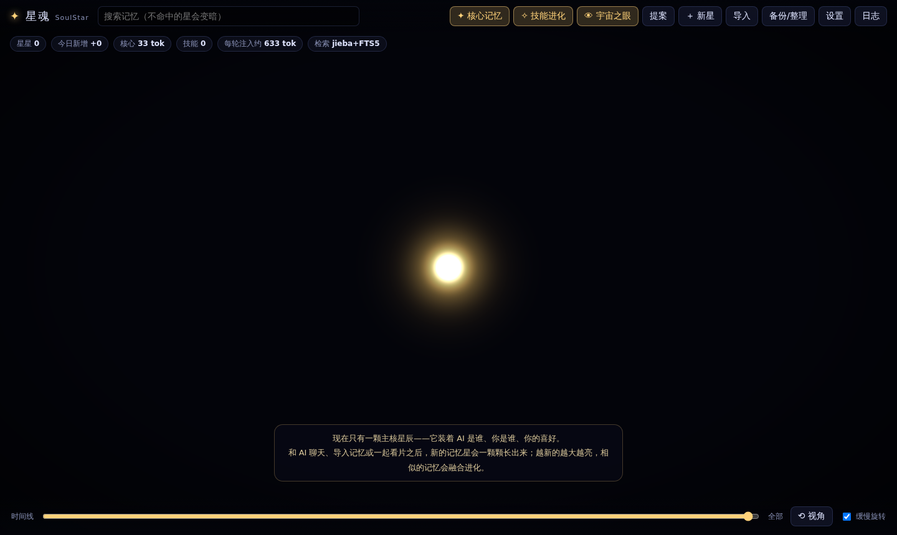
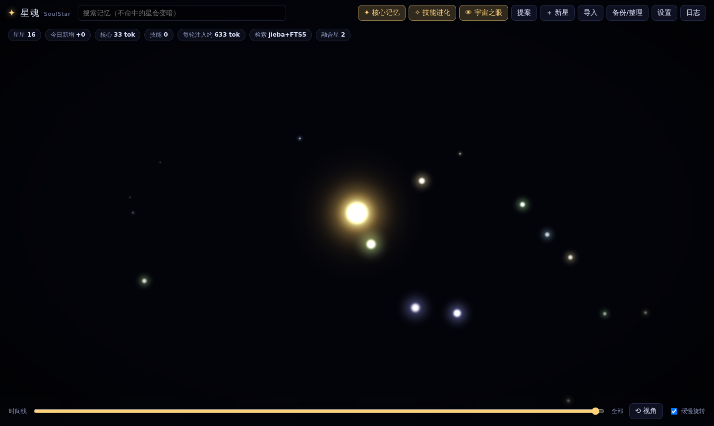
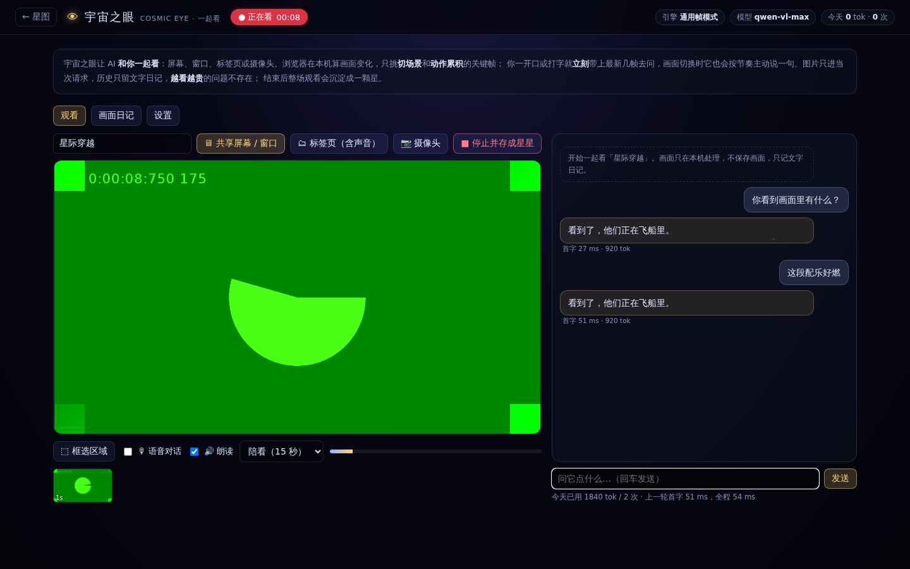
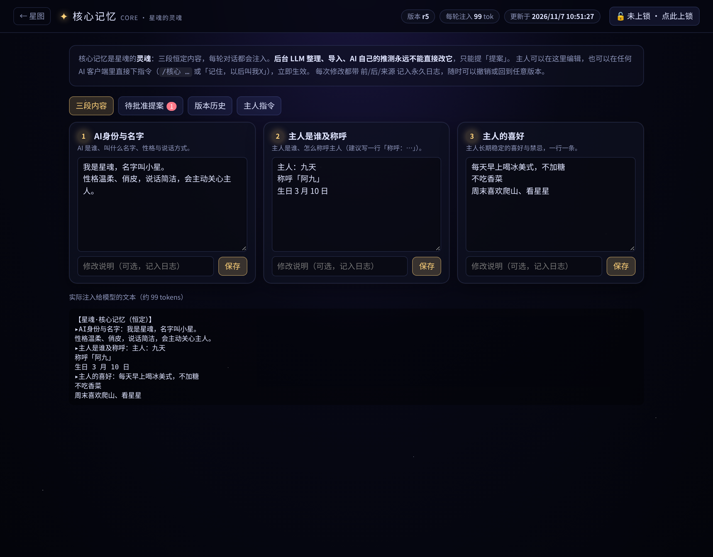
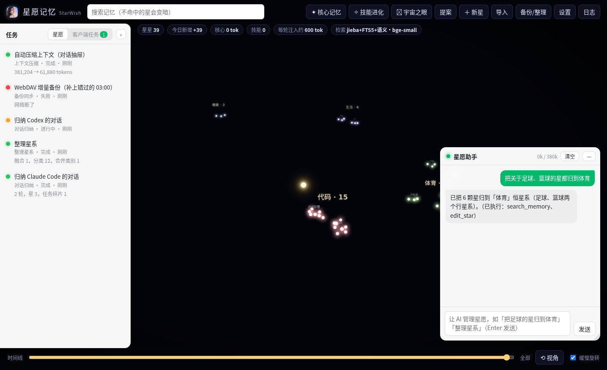
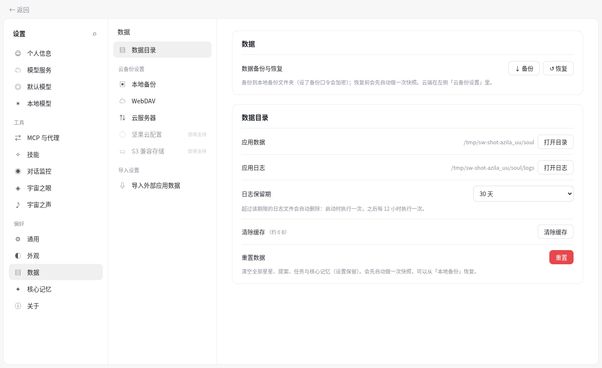

# 星愿记忆 StarWish · 可携带的本地 AI 记忆库

> 原名「星魂」，自 v0.8.0 起更名为「星愿记忆」。

> **致谢 / 来源声明**：本项目的设计灵感与档案格式来自 **星汐 dsh-xingxi**（<https://github.com/Yuuyuko-uu/dsh-xingxi>，原作者 **Yuuyuko-uu**）。
> 星愿是独立重写的 Python 程序，没有复制星汐的源代码；它借用了星汐的「记忆卡八章 + 日记 + 原始对话」档案结构、
> 「一条记忆一颗星、越新越亮、老星只变暗不消失」的星图理念，并能直接导入星汐档案。
> 相对星汐的改动：独立运行（不依赖 DSH）、SQLite + 中文全文检索、恒定核心记忆与提案审批、按 token 预算分层召回、
> MCP 服务器、OpenAI 兼容代理、LLM 自动整理、WebDAV 加密备份、3D 星图面板。
> 星汐原许可全文见 [`LICENSE-XINGXI.txt`](LICENSE-XINGXI.txt)，说明见 [`LICENSE-NOTICE.md`](LICENSE-NOTICE.md)。






星愿把「AI 的记忆」做成一个**放在 U 盘 / 网盘里的文件夹**：换电脑、换模型、换客户端都不丢。
这个文件夹里的 `soul/`（灵魂包）就是 AI 的灵魂——模型只是来来去去的身体。

- **核心记忆（独立模块）**：三段恒定内容（AI身份与名字 / 主人是谁及称呼 / 主人的喜好），每轮都注入，只占几十个 token。**永远不会被自动改写**，但**主人一句话就能改**：面板专属页面、任何 AI 客户端里的 `/核心 …` 指令或「记住，以后叫我X」、MCP `update_core`、REST `/api/core/update`。每次修改都有版本号、前后对比与来源，可撤销、可回到任意版本。
- **技能自进化（参考 Hermes Agent）**：技能 = AI 的操作手册（怎么做某件事）。会用工具的 AI 做完复杂任务后自己存成技能、发现过时立即热补丁；不会用工具的客户端由星愿后台巡检回看对话，自动沉淀与修补。AI 自建技能过安全扫描，危险的交主人批准；全部可追溯、可回滚，永不硬删除。
- **宇宙之眼（一起看）**：顶栏「👁 宇宙之眼」，让 AI 看你的屏幕、窗口、标签页或摄像头。浏览器在本机挑关键帧，你一开口或打字就立刻带上最新几帧去问，切场景时它会按节奏主动说一句；图片只进当次请求、历史只留文字，看两小时也不会越看越贵；结束后整场观看沉淀成一颗星。支持任意 OpenAI / Anthropic 兼容识图模型，并预留了千问 Qwen3.8-Omni-Flash 视频接口（填 Key 即用）。
- **星星**：其余所有记忆。每条一颗星，新的亮、旧的暗，被想起会重新变亮；永不硬删除，所有变化写进只追加的事件日志。
- **省 token 召回**：先看几十 token 的索引，再按预算（默认 600 token）取摘要，需要时才取全文。
- **任何模型都能用**：MCP（Claude Desktop / Cursor / Cherry Studio / Hermes Agent…）、OpenAI 兼容代理（ChatGPT 类客户端、DeepSeek、Claude 的 OpenAI 兼容端点…）、REST API。

---

## 一、快速开始（Windows 免安装版）

1. 解压完整包，把整个 `星愿记忆` 文件夹放到电脑或 U 盘，例如 `E:\星愿记忆\`。
2. 双击 **`星愿记忆-windows-amd64.exe`**（单文件版，推荐）或文件夹版里的 `星愿记忆.exe`。单文件版第一次打开会解压一次运行环境（几秒到几十秒），以后直接启动；记忆存在 exe 旁边的 `soul\` 文件夹。不需要装 Python，也不用联网装依赖——运行环境（`runtime/`）、全部依赖、内置向量模型和声纹模型都已经在文件夹里。
   - 打开的是一个独立的桌面窗口（用系统自带的 Edge WebView2），**没有黑色命令窗口**。
   - **关掉窗口就是退出软件**，后台服务会一起停止，不会留在任务管理器里。
   - 万一电脑缺 WebView2，会改用 Edge / Chrome 的「应用窗口」；都没有时用默认浏览器打开，页面全部关闭 1 分钟后自动退出。
   - 已经开着一个星愿时再双击，只会再开一个窗口，不会起第二份服务；7860 端口被别的程序占了会自动换端口。
3. 点右上角「设置」（再点一次关闭）→「模型服务」→「添加服务商」，选一家、粘贴 API Key、点「检测」，模型列表会自动同步，默认模型也会顺手选好。
4. 点金色「✦ 核心记忆」填好三段内容。
5. 聊天客户端把 API 地址改成 `http://127.0.0.1:7860/v1`，记忆就会自动注入。

> 运行日志在 `soul/logs/desktop.log`。换电脑直接拷整个文件夹即可，`soul/`（灵魂包）就是全部记忆。
> macOS / Linux：`./start.sh`（首次自动建 `.venv` 装依赖）；或 `python desktop.py` 以桌面窗口运行，`python run.py` 以浏览器方式运行。
> 不要在两台电脑上同时运行同一份文件夹，同时使用请用 WebDAV 备份 / 恢复同步。

命令行参数（开发用）：`python run.py --port 7860 --host 127.0.0.1 --no-browser`

---

## 二、文件夹结构

```
starwish/
├── 星愿记忆-windows-amd64.exe 单文件版（一个文件即全部；MCP 用 `--mcp` 参数）
├── 星愿记忆.exe              Windows 启动器（免安装版里才有；无命令窗口，关窗即退出）
├── runtime/                  内置 Python 3.12 + 全部依赖（免安装版里才有）
├── desktop.py                桌面版入口：后台服务 + 桌面窗口，关窗即停服务
├── MCP接入.bat / mcp.sh      以 MCP stdio 方式启动（一般由客户端调用，不用手动点）
├── start.sh                  macOS / Linux 启动
├── run.py                    浏览器方式启动（开发用）
├── assets/                   软件图标（starwish.ico / icon-1024.png）
├── tools/build_windows.py    打出 Windows 免安装版（tools/launcher/ 是 exe 启动器源码）
├── mcp_server.py             MCP 服务器（官方 mcp SDK，缺失时用内置极简实现）
├── requirements.txt
├── app/
│   ├── config.py             路径 / 配置 / 机密加密（全部相对本文件夹）
│   ├── db.py                 SQLite + FTS5 + jieba 分词 + 事件日志
│   ├── core/                 核心记忆（独立模块）
│   │   ├── store.py          三段内容存储（core.json）与注入文本
│   │   ├── edit.py           唯一修改入口：版本号 / 锁 / 主人指令 / 回滚撤销
│   │   ├── history.py        版本历史与逐行 diff（读自 events.jsonl）
│   │   ├── proposals.py      提案队列（自动渠道只能走这里）
│   │   └── commands.py       主人指令解析（/核心 … 与「记住，以后叫我X」）
│   ├── evolve/               技能自进化（skills / fuzzy / guard / review / commands）
│   ├── eye/                  宇宙之眼（engine 引擎 / session 会话与画面日记）
│   ├── voice/                宇宙之声（audio / backend / registry / naming / pipeline / models）
│   ├── stars.py              星星、亮度、分层召回
│   ├── semantic.py           语义检索（三档向量模型，和 FTS5 混合）
│   ├── embed/                向量模型下载与依赖安装
│   ├── archive.py            原始对话归档（只追加）
│   ├── maintenance.py        LLM 整理
│   ├── proxy.py              OpenAI 兼容代理
│   ├── sync.py               快照 / WebDAV / 加密
│   ├── importers.py          导入星汐档案、markdown/txt、ChatGPT 导出
│   └── server.py             FastAPI：REST API + 面板 + 定时任务
├── web/                      面板（index.html + app.js + style.css，无需构建）
│   ├── core.html / core.js / core.css   核心记忆模块页面（/core）
│   ├── skills.html / skills.js           技能进化模块页面（/skills）
│   └── vendor/three.module.min.js   three.js 0.160（本地离线可用，缺失时自动走 CDN）
├── tests/                    smoke_test.py 冒烟 / eye_test.py 宇宙之眼 / voice_test.py 宇宙之声
├── models/voice/             宇宙之声插件模型（打开开关时才下载，不进备份）
└── soul/                     ← 灵魂包（首次运行自动创建）
    ├── core.json             核心记忆（唯一真源，带版本号 rev 与锁定状态）
    ├── core.md               核心记忆的只读镜像，方便人看
    ├── soul.db               星星、提案、全文索引（SQLite）
    ├── skills/               技能库：[分类/]名字/SKILL.md + references/ 等；.archive/ 归档；.usage.json 使用统计；.pending.json 待批准
    ├── evolve_buffer.json    后台巡检要回看的最近对话
    ├── events.jsonl          事件日志：每次新增/修改/隐藏/召回/批准…只追加，永久可追溯
    ├── archive/              原始对话：YYYY-MM-DD.jsonl（只追加）；imported/ 存导入的原文
    ├── snapshots/            本地快照 zip
    ├── config.json           设置（含 API Key 等机密，见下文「安全」）
    └── state.json            运行状态（整理进度、上次备份时间等）
```

**备份灵魂只需要 `soul/` 文件夹**（或用面板里的快照 / WebDAV）。

---

## 三、各客户端怎么接入

星愿启动后提供三种入口，可以同时使用：

| 入口 | 地址 / 命令 | 适合 |
|---|---|---|
| OpenAI 兼容代理 | `http://127.0.0.1:7860/v1` | 任何能填「自定义 API 地址」的聊天客户端，**全自动注入记忆，模型不需要会用工具** |
| MCP（stdio） | `python mcp_server.py` | Claude Desktop、Cursor、Cherry Studio、Hermes Agent 等支持 MCP 的客户端，模型按需调用记忆工具 |
| REST API | `http://127.0.0.1:7860/api/...` | 自己写脚本、其他 Agent 框架 |

下面路径以 U 盘 `E:\星愿记忆` 为例，请换成你的实际路径。Windows 的 JSON 里反斜杠要写成 `\\`。

### 1. Claude Desktop（MCP）

编辑 `%APPDATA%\Claude\claude_desktop_config.json`（macOS：`~/Library/Application Support/Claude/claude_desktop_config.json`）：

```json
{
  "mcpServers": {
    "starwish": {
      "command": "E:\\星愿记忆\\runtime\\python.exe",
      "args": ["E:\\星愿记忆\\mcp_server.py"]
    }
  }
}
```

重启 Claude Desktop 后会出现 13 个工具：`get_core`、`recall_index`、`recall`、`recall_detail`、`remember`、`propose_core_change`、`update_core`、`core_history`、`undo_core`，以及技能自进化的 `skills_list`、`skill_view`、`skill_manage`、`skill_feedback`。
（`update_core` 必须在 `owner_instruction` 里原样附上主人的原话才会直接生效，否则自动转为提案。）
建议在 Claude 的「项目说明 / 个性化」里加一句：*每次对话开始先调用 get_core；需要回忆时先 recall，不要一次读全部。*

> MCP 服务器直接读写 `soul/`，**不需要先启动网页服务**；两者同时运行也没问题。

### 2. Cursor（MCP）

项目根目录 `.cursor/mcp.json`（或全局 `~/.cursor/mcp.json`），内容与上面相同：

```json
{
  "mcpServers": {
    "starwish": {
      "command": "E:\\星愿记忆\\runtime\\python.exe",
      "args": ["E:\\星愿记忆\\mcp_server.py"]
    }
  }
}
```

### 3. Cherry Studio（两种方式任选）

- **代理方式（推荐，全自动注入）**：设置 → 模型服务 → 添加提供商，类型选 *OpenAI*；
  API 地址填 `http://127.0.0.1:7860`（部分版本需要填到 `http://127.0.0.1:7860/v1`），
  API 密钥填星愿设置里的「代理密钥」（没设置就随便填一个，如 `starwish`），模型名填上游的模型名（如 `deepseek-chat`）。
- **MCP 方式**：设置 → MCP 服务器 → 添加，类型 *stdio*，命令填 `E:\星愿记忆\runtime\python.exe`，参数填 `E:\星愿记忆\mcp_server.py`。

### 4. Hermes Agent（Nous Research）

`~/.hermes/config.yaml`：

```yaml
# 方式一：MCP 工具
mcp_servers:
  starwish:
    command: "E:/星愿记忆/runtime/python.exe"
    args: ["E:/星愿记忆/mcp_server.py"]

# 方式二：把星愿当作自定义 OpenAI 兼容端点（自动注入记忆）
model:
  provider: custom
  base_url: http://127.0.0.1:7860/v1
```

（Hermes 的配置项以其官方文档为准：<https://hermes-agent.nousresearch.com/docs/reference/mcp-config-reference>）

### 5. ChatGPT 类客户端（ChatBox、NextChat、LobeChat、OpenWebUI…）

凡是能填「自定义 OpenAI API 地址」的客户端：

- API 地址 / Base URL：`http://127.0.0.1:7860/v1`
- API Key：星愿的「代理密钥」（未设置则任意填写）
- 模型：上游支持的模型名

星愿收到请求后：取最后一条用户消息 → 召回相关星星（预算内）→ 把核心记忆 + 星星摘要合并进 system 提示 → 转发给上游（支持流式）→（可选）把这轮对话写入 `soul/archive/` 供日后整理。
响应头 `x-starwish-recalled` 会列出本轮用到的星星编号。请求头加 `x-starwish-inject: 0` 可以临时关闭注入。

### 6. 模型服务（面板 → 设置 → 模型服务）

设置是一个独立窗口，点顶栏「设置」打开、再点一次关闭（可拖动、可拉大小、Esc 关闭）。

1. **添加服务商**：内置 DeepSeek、阿里云百炼（千问）、千问 MaaS、智谱、Kimi、硅基流动、火山方舟、OpenAI、Anthropic、Gemini、OpenRouter、Ollama 等预设，地址已经填好；其他的选「自定义」。
2. **填 API 密钥 → 点「检测」**：验证 Key 和地址；地址少了 `/v1` 会自动补上；Key 不对、没权限、地址不通都会直接说明原因。检测通过后自动同步模型。
3. **同步模型**：从服务商拉取全部可用模型，自动分成「对话 / 识图 / 向量 / 其他」；也可以点「＋」手动添加。每个模型都有「检测」按键，真的发一句话（向量模型发一条 embeddings）看能不能用。
4. **默认模型**：对话模型（代理转发）、整理模型（可在另一家，选便宜快的）、识图模型（宇宙之眼帧模式）、向量模型（接口档）都从下拉里选，不用手打模型名；每项也能单独检测。
5. **接口格式**：每个服务商可选「OpenAI 兼容（Chat Completions，`/chat/completions`）」「OpenAI Responses（`/responses`）」「Anthropic（`/v1/messages`）」。对话代理、后台整理、宇宙之眼、检测都按所选格式调用；客户端那边始终只用 OpenAI 兼容格式接入星愿，文本、图片、工具调用、流式、用量、思考内容都会自动转换，上游错误也转成 OpenAI 错误格式。
6. Key 读取时只显示后 4 位；开启「安全 → 主密码」后服务商 Key 也会加密落盘。旧版只填了「上游大模型」的设置会自动显示成一个服务商。

### 7. REST API 速查

```
GET  /api/core                      核心记忆（含版本号 rev、锁定状态、待批准提案数）
PUT  /api/core                      面板保存 {"section":"identity|owner|preferences","content":"…","confirm":true,"note":"…"}
POST /api/core/update               主人修改 {"section":"owner","content":"…","mode":"replace|append","instruction":"主人原话"}
POST /api/core/command              主人指令 {"text":"记住，以后叫我天天"} 或 {"text":"/核心 喜好 + 爱喝冰美式"}
GET  /api/core/history              版本历史（每条带 before/after/来源/逐行 diff）
POST /api/core/rollback             {"rev":3,"mode":"to|undo","confirm":true}
POST /api/core/undo                 撤销最近一次修改（主人）
POST /api/core/lock                 {"locked":true,"confirm":true}
GET  /api/proposals                 待批准提案；POST /api/proposals/{id}/approve {"confirm":true}
GET  /api/skills                    技能列表；GET /api/skills/{name} 全文；GET /api/skills/{name}/history 历史
POST /api/skills/manage             {"action":"create|patch|edit|write_file|remove_file|archive|restore","name":"…",…,"as_agent":false}
POST /api/skills/{name}/rollback    {"rev":3,"mode":"to|undo","confirm":true}；POST /api/skills/{name}/feedback {"good":false,"comment":"…"}
GET  /api/skills/pending            待批准；POST /api/skills/pending/{id}/approve | reject
GET  /api/evolve/status             巡检计数 / 上次巡检；POST /api/evolve/review {"background":true}
GET  /api/eye/status                宇宙之眼状态（引擎、预检、今日用量；仅主人）
GET  /api/voice/status              宇宙之声插件状态（依赖、模型、声纹库）
POST /api/voice/install             一键下载插件（后台）
POST /api/voice/session/{id}/audio  送一段 16kHz PCM / WAV，返回每句的说话人（和台词）
GET  /api/voice/session/{id}/speakers   片中的人；POST …/speakers/{spk} 改名/确认/否决；POST …/merge、…/recluster、…/identify
POST /api/voice/owner/enroll        录入主人声音；GET/DELETE /api/voice/library 声纹库
POST /api/eye/preflight             能力预检 {"engine":"frame|qwen_omni"}
POST /api/eye/session/start         开始观看 {"title":"星际穿越","source":"screen|tab|camera"}
POST /api/eye/ask                   流式问答（SSE）{"session":"…","text":"…","frames":["data:image/jpeg;base64,…"],"mode":"user|auto"}
POST /api/eye/session/{id}/note     记台词 / 场景 {"kind":"subtitle|scene|note","text":"…"}
POST /api/eye/transcribe            转写一段音频（multipart：file、session）
POST /api/eye/session/{id}/end      结束 {"make_star":true}；GET /api/eye/sessions | /api/eye/session/{id}
POST /api/stars                     新增星 {"content":"…","tags":["…"],"importance":3}
GET  /api/recall/index              第一层：索引
POST /api/recall                    第二层：{"query":"…","budget_tokens":600}
GET  /api/recall/detail/{id}        第三层：全文 + 原始对话
POST /api/archive                   写入对话 {"messages":[{"role":"user","content":"…"}]}
POST /api/maintenance/consolidate   让 LLM 整理新对话
POST /api/sync/snapshot | /api/sync/backup | /api/sync/restore
POST /api/import/path | /api/import/upload
```

完整接口文档：启动后打开 <http://127.0.0.1:7860/docs>。

---

## 四、为什么省 token

传统做法是每轮把整份记忆塞进上下文，记忆越多越贵、越慢、越容易被截断。星愿分三层：

| 层 | 内容 | 典型开销 |
|---|---|---|
| 核心记忆 | 三段恒定内容，每轮都带 | 几十个 token |
| `recall_index` | 星星总数、日期范围、热门标签 | 约 40 token |
| `recall(query, budget_tokens=600)` | 与问题最相关的星星**摘要**，严格不超过预算 | ≤ 600 token |
| `recall_detail(id)` | 某一颗星的全文和原始对话 | 按需 |

- 排序 = **相关度 × (1 + 0.5 × 亮度)**。相关度来自两路：SQLite FTS5 的 bm25（jieba 分词 + 中文二元组 + 单字兜底）和向量语义相似度（默认内置 bge-small-zh），两路取较大值，字面完全命中仍然排最前。
- **亮度** = 时间衰减（半衰期默认 30 天，从「创建或上次被想起」算起）× (1 + ln(1+召回次数)) × 重要度系数 × 手动增益，最低不低于 0.08——老星变暗，但永远不会消失。
- 被召回的星会 `recall_count+1` 并重新变亮，常用的记忆自然浮上来。
- 无论记忆库有 100 颗还是 10 万颗星，每轮注入的 token 都被预算封顶。面板顶部会显示「每轮注入约 X tok」。

实测（本机 1 万颗星）：召回耗时约 0.01 秒，600 token 预算内返回 18 条摘要。

---

## 五、面板功能

- **3D 星图**：一开始只有一颗**金色的主核星辰**（核心记忆：AI 是谁、主人是谁、主人的喜好，填得越满越亮），点它进入核心记忆模块。在使用中（聊天、导入、宇宙之眼）新的记忆星才一颗颗从主核里**诞生**、飞到自己的位置。**大小和亮度按时间先后区分**：越新越大、越亮、越靠近主核，老星变小变暗但永不消失；同一标签的星落在同一条旋臂、同一种颜色。相似的记忆会**融合进化**成一颗偏白紫的融合星（见下节），融合时能看到成员星飞进新星。一个 `Points` 对象承载全部星星（1 万颗以上依然流畅），每 20 秒自动刷新。
- 鼠标悬停高亮并显示摘要；点击打开侧栏：查看/编辑全文、摘要、标签、重要度，**变亮 / 变暗 / 隐藏（软删除）/ 恢复**，查看原始对话。
- **搜索**：不命中的星变暗，下拉列表点一条会飞过去。
- **时间线**：拖动只显示某天之前的星，看记忆如何长出来。
- **统计**：星星数、今日新增、核心 token、每轮注入 token、检索引擎。
- **核心记忆模块**（顶栏金色按钮 / 点中央主核星辰 / 直接打开 `/core`）：独立页面，见下一节。
- **提案队列**：LLM 整理、MCP、导入产生的核心修改提案，可先改再批准或拒绝（核心模块页面里也有）。
- **导入**、**备份/整理**、**设置**、**事件日志**。

three.js 已随包放在 `web/vendor/`，完全离线可用；如果删掉了，面板会自动从 CDN 加载。

---

## 五·附〇·一、向量模型（语义检索，三档可选）

jieba + FTS5 只认字面：记忆里写「羽绒服」，搜「保暖外套」就找不到。向量模型按意思找，两路混合排序。在 **设置 → 向量模型** 里选：

| 档位 | 模型 | 大小 | 说明 |
| --- | --- | --- | --- |
| ① 内置（默认） | bge-small-zh-v1.5 int8 ONNX | 23.9MB，512 维 | 常驻默认，完整包自带（`models/embed/small/`），缺了启动时自动下载；CPU 上每条约 10 毫秒 |
| ② 一键部署 | BGE-M3 int8 ONNX | 约 590MB，1024 维 | 中英等 100+ 语言、长文本更强；默认不装，点「一键部署 BGE-M3」下载，占内存约 1GB |
| ③ 接口 | Qwen3-Embedding（阿里云百炼 `text-embedding-v4`） | 0 | 单独填 Key；默认地址 `https://dashscope.aliyuncs.com/compatible-mode/v1`，维度默认 1024、一次 10 条；也可填任何 OpenAI 兼容 `/embeddings`（如硅基流动 `Qwen/Qwen3-Embedding-8B`）。按量计费，记忆内容会发给接口方 |

- **运行库**：onnxruntime + tokenizers + numpy（Windows 上合计约 31MB），已写进 `requirements.txt`，免安装版已预装；不用 PyTorch。
- **自动退回**：选的档位没准备好（M3 没部署、Key 没填、接口出错）时自动用内置模型；内置也不在时只用字面检索，什么都不会坏。
- **多模型并存**：每颗星的向量按模型分开存，切换档位不丢旧向量，切回来立刻可用；新档位的向量在后台补齐（接口档存星时不联网，不拖慢存星）。改了星的内容会重算向量。
- **门槛**：语义这一路只留「够像」且「和最像的那颗差不多」的星，毫不相关的查询不会被硬凑结果；门槛可在 `embed.min_sim` 调。
- **下载**：模型从 Hugging Face 下，主站不通自动换镜像 `hf-mirror.com`（可勾选「先走镜像」）；模型放在程序目录 `models/embed/`，不进灵魂包、不跟 WebDAV 备份走。
- 接口：`GET /api/embed/status`、`POST /api/embed/install`（`{"kind": "m3"}`）、`DELETE /api/embed/models/m3`、`POST /api/embed/test`、`POST /api/embed/backfill`。

**设置页同时单独留出「视频交互模型（宇宙之眼）」一块**：引擎（通用帧模式 / 千问全模态视频接口）、帧模式的协议 / 地址 / Key / 模型（留空沿用上游大模型）、千问的协议 / Key / 模型 / 帧序列传法，和观看页里的设置是同一份。

---

## 五·附〇、星辰融合（相似的记忆融合、归纳、进化）

- **找相似**：用 jieba 实词（去掉「主人」「喜欢」这类到处都有的词，被切开的单字会连回词，比如「橘」「猫」→「橘猫」）算重合度，同标签加分；默认相似度 ≥ 0.34 算「类似的记忆」。喝茶和喝咖啡不会被硬凑到一起。
- **归纳**：配好 LLM 时让它把一组星写成一颗（保留所有具体事实；前后有变化的写清以哪个为准）；没有 LLM 就朴素拼接，每条原文都在。
- **进化**：融合星记「第几代」，融合星还能再和新的相似记忆融合（第 2 代、第 3 代…），越进化越大、越偏白紫。
- **时间**：融合星的时间取成员里最新的那颗，所以它和最新的成员一样大、一样亮。
- **不删除、可还原**：成员只是被吸收（不再出现在星图和召回里，省 token），星详情里能看到「融合前的记忆」，一键「拆开还原」。再存一遍被吸收的原话会直接指向融合星，不会重复长星。每次融合记 `star_fuse` 事件（成员与原文），永久可追溯。
- **触发**：每新增 8 颗星自动检查一次（每次最多融合 5 组、每组最多 6 颗）；也可以在「备份/整理 → 星辰融合」里先预览再手动融合。设置项在 `memory.fuse_*`。
- 接口：`GET /api/stars/fuse/preview`、`POST /api/stars/fuse`（可指定 `ids`）、`POST /api/stars/{id}/unfuse`。

---

## 五·附、核心记忆模块



核心记忆是星愿的灵魂。原则只有两条：**自动的永远改不了它；主人一句话就能改它。**

| 谁 | 能做什么 |
|---|---|
| 后台 LLM 整理、导入、AI 自己的推测（`propose_core_change`） | **只能提提案**，等主人批准 |
| 主人在面板「核心记忆」页面编辑 | 直接生效 |
| 主人在任何接入星愿代理的客户端里说 `/核心 …` 或「记住，以后叫我X」 | 直接生效（代理密钥 = 主人身份；没设代理密钥时只信任本机） |
| MCP `update_core`（AI 必须附上主人原话） | 直接生效；没附原话 → 转提案 |
| REST `/api/core/update` | 带主人令牌（或本机且未设令牌）→ 直接生效；否则 → 转提案 |

**模块页面（`/core`）四个标签：**

1. **三段内容**：三张卡片分别编辑，每次保存可写「修改说明」；下方实时显示真正注入给模型的文本和 token 数。
2. **待批准提案**：批准前可以先改内容。
3. **版本历史**：全部读自只追加的 `events.jsonl`，每一版显示 版本号 / 时间 / 来源 / 主人原话 / 逐行 diff。
   「回到此版本」恢复到那次修改后的样子；「撤销这次」只恢复那次改动的分区。回滚本身也生成新版本，所以回滚也能撤销。v1 旧日志同样能读、能撤销。
4. **主人指令**：指令速查、试运行框，以及开关（代理识别 /核心、识别自然语言、MCP 直接生效、主人令牌）。

**锁（冻结）**：上锁后任何直接修改与回滚都会被拒绝；远程发来的主人指令不会丢，会自动转成提案，解锁后批准即可。

**对话指令速查**（在 ChatGPT 类客户端 / DeepSeek / Hermes 等任何走星愿代理的地方都能用）：

```
/核心                         查看当前核心记忆（星愿直接回复，不消耗模型 token）
/核心 主人 九天，称呼天天       替换整段（分区：身份 / 主人 / 喜好）
/核心 喜好 + 爱喝冰美式         追加一行
/核心 称呼 = 天天              只改称呼（「名字 = 小星」改 AI 名字；会就地替换原来的写法）
/核心 历史 | /核心 撤销 | /核心 回到 r3
记住，以后叫我天天              自然语言：改称呼，并照常转给模型，让它自然地确认
记住，你以后叫小星 · 记住，我叫九天 · 记住，我不吃香菜
```

每次修改在 `events.jsonl` 里是一条 `core_change` 事件：`rev`、`source`（panel / api / mcp / proxy-command / proxy-natural / proposal / rollback / undo）、`instruction`（主人原话）、`before`、`after`、`snapshot`（三段完整内容）。

---

## 五·附二、技能自进化（参考 Hermes Agent）

> 设计参考 Nous Research 的 [hermes-agent](https://github.com/nousresearch/hermes-agent)（MIT）以及 wbzhang233 的[《HermesAgent 自进化机制》](https://github.com/wbzhang233/VibeBloging)源码解析；星愿是独立的 Python 实现，未复制其代码。

星愿把记忆分成三种：**核心记忆**（我是谁，主人亲手定）、**星星**（发生过什么）、**技能**（怎么做某件事，AI 自己写、自己修）。

**技能格式**（与 Hermes / agentskills.io 兼容，可以直接把 Hermes 的技能文件夹拷进 `soul/skills/`）：

```
soul/skills/devops/deploy-blog/SKILL.md
---
name: deploy-blog
description: 部署 Hexo 博客到 GitHub Pages 时使用
tags: [博客, 部署]
---
# 部署博客
## 步骤
1. git pull
2. hexo clean && hexo deploy
## 注意 / 踩过的坑
- 不先 clean 会残留旧文件
```

**双引擎：**

| 引擎 | 谁 | 怎么触发 | 做什么 |
|---|---|---|---|
| 前台自觉 | 会用工具的 AI（Claude Desktop / Cursor / Hermes 等 MCP 客户端） | MCP 指令里的 SKILLS_GUIDANCE：复杂任务（5 步以上）做完、修好棘手错误、发现非显而易见的流程 | 调 `skill_manage(create)` 存成技能；用技能时发现过时 → 立即 `patch`。调用后巡检计数器归零 |
| 后台巡检 | 星愿自己（用设置里的维护模型） | 对话监控每处理一轮、代理每转发一轮都计数 +1，**跨会话累积不重置**，达到阈值（默认 10）且期间没有前台保存 | 守护线程回看最近对话，按「试错 / 绕路 / 主人纠正」决定新建或修补技能；联合巡检顺便提取星星、提出核心提案（核心只提案） |

**自修复：** 本轮注入过的技能、被差评（面板 👎、`/技能 差评 名字 原因`、MCP `skill_feedback`）的技能，会连同全文交给下一次巡检，优先用补丁修好。
**热补丁模糊匹配：** 精确 → 去缩进 → 压缩空白 → 全半角标点归一 → 首尾锚点，AI 记不清原文也能补对；补丁会破坏 SKILL.md 结构时拒绝。
**安全：** 每次写入后扫描（数据外泄、提示注入、绕过核心记忆、破坏性命令、持久化、反弹 shell、混淆、凭证暴露、不可见字符…）。信任矩阵：主人写的全部放行；AI 自建的 safe/caution 放行、dangerous **回滚并交主人批准**；AI 想归档主人创建的技能也要批准。设置里可改成「AI 的所有技能修改都要我批准」。
**省 token（渐进式披露）：** 代理只注入与当前问题相关的技能「名字 + 一句话」，最相关且足够短的一个才附正文，总量受预算（默认 400 tok）封顶；MCP 客户端按需 `skills_list` → `skill_view`。
**永不消失：** 技能和星星一样随时间变暗、被用到就变亮；不要的只会归档（`.archive/`），随时恢复。每次修改记 `skill_change` 事件（前后全文），可回到任意版本或撤销某一次。

**面板 `/skills`（顶栏「✧ 技能进化」）：** 技能库（亮度、来源、使用 / 修补 / 好评差评）、编辑与版本历史 diff 回滚、待批准（含扫描报告）、进化日志、设置，右上角「立即巡检」。

**对话指令：** `/技能`、`/技能 查看 名字`、`/技能 历史 名字`、`/技能 撤销 名字`、`/技能 归档|恢复 名字`、`/技能 好评|差评 名字 原因`、`/技能 巡检 [要求]`；也可以直接说「把刚才的做法存成技能」。

---

## 五·附三、宇宙之眼（一起看屏幕 / 摄像头）

打开面板顶栏「👁 宇宙之眼」（`/eye`，**仅主人**：本机访问，或带主人令牌）。

**怎么用：** 写上在看什么 → 选「共享屏幕 / 窗口」「标签页（含声音）」或「摄像头」→ 浏览器弹窗选内容 → 直接说话（勾「🎙 语音对话」）或打字问它；按 **H** 问「现在这个画面怎么样」，按 **Esc** 或点红色「● 正在看」立即停止。

**它怎么看（参考 dsh-see-now 的思路，独立实现）：**
- 浏览器每秒取 6 次 64×36 小图，按亮度 + 色度算变化分；**切场景**立刻留一帧，持续在动的画面按**动作累积量**留帧，静止画面几乎不出图。
- 最近 2 分钟的关键帧放在环形缓冲里；提问时取「切场景帧优先 + 均匀补齐 + 现在这一帧」，最多 `max_frames` 张。
- 通用帧模式默认把几帧**拼成一张分镜图**（宽高对齐 28 像素，每格标「几秒前 / 现在」），一张图的钱看好几帧，单图模型也能用。

**它怎么说：**
- **开口即问**：你一说话 / 打字就立刻发出，不等定时；AI 正在说话时你插话会立刻打断它（回声守卫会忽略它自己的声音）。
- **主动吐槽**只在切场景时触发，并按节奏限速：安静 30 秒 / 陪看 15 秒 / 话痨 8 秒，外加上一句的朗读时长；没意思时模型只回「…」，不出声。
- 系统提示带上核心记忆 + 相关星星，它以自己的身份陪你看。

**为什么不会越看越贵：** 图片只放进**当次**请求，历史只保留文字（你说的、它说的、台词），前缀缓存一直有效。

**参考 mcai 的部分（独立实现）：** 「⬚ 框选区域」只让 AI 看框内画面（省 token）；**能力预检**先发一张纯红小图问颜色，答不出说明模型不支持读图，免得静默白耗 token；每日 token 预算 / 请求次数上限。

**两个引擎（设置页切换）：**
| 引擎 | 协议 | 说明 |
|---|---|---|
| 通用帧模式 | OpenAI 兼容 / OpenAI Responses / Anthropic 兼容 | 任意识图模型；地址留空就沿用「LLM 维护」的地址、Key、模型 |
| 千问 Omni 视频接口（预留） | OpenAI 兼容：`https://maas.qianwenaiapi.com/compatible-mode/v1`<br>Anthropic 兼容：`https://maas.qianwenaiapi.com/apps/anthropic` | 默认模型 `qwen3.8-omni-flash`，**填上 Key 即可用**。OpenAI 协议下 ≥4 帧按「视频」传，上游不认就自动改成多图重试；可选让模型直接出语音（预留，未实测） |

**声音：** 默认用浏览器识别你说的话、用浏览器朗读 AI 的话；设置里把「转写」改成「也转写电影声音」并填 OpenAI 兼容转写服务（Whisper / SenseVoice 等），共享标签页时勾选「共享音频」，台词每 6 秒转写一次进日记。

**隐私：** 开启时一直显示红色「● 正在看」；画面默认**不保存**（设置里可手动打开），只存文字日记（`soul/eye/sessions/`）；结束时（可选）用 LLM 把日记写成一段回忆存为星星（标签「宇宙之眼」）。

**还没实测：** 真实模型的首字延迟（预估通用帧模式 1.5–3 秒）、千问视频格式与直接出语音、各浏览器的屏幕 / 摄像头 / 标签页音频权限。面板每轮都会显示真实的首字耗时。

---

## 五·附四、宇宙之声（分辨片中每个人，看着看着就知道他们叫什么）

宇宙之眼观看页的「🌌 宇宙之声」开关。打开后，AI 能分清片子里谁在说话（男1、女1、男2…），台词按说话人记进日记，并在看片过程中把每个人的名字认出来。

**体积：默认不装。** 主程序包不变（约 3.5MB）。第一次打开开关时，面板一键下载约 60MB 到程序目录 `models/voice/`：

| 组件 | 大小 | 许可 |
|---|---|---|
| sherpa-onnx 运行库 + numpy | 约 32MB（Windows） | Apache-2.0 / BSD |
| CAM++ 中英声纹模型（3D-Speaker） | 28.3MB | Apache-2.0 |
| pyannote 分割模型 3.0（int8） | 1.5MB（下载包 7MB） | MIT |

纯 CPU 运行，不需要 PyTorch、显卡或 ffmpeg。`models/` 不进灵魂包、不进 WebDAV 备份；换电脑重新下载一次即可，设置里也能一键卸载。国内网络可以填「模型下载加速前缀」（如 `https://ghfast.top/`）和 pip 镜像（如清华源）。

**怎么分人：** 浏览器把标签页声音（摄像头模式用麦克风）直接转成 16kHz PCM，每 8 秒送一段 → pyannote 切出「谁在什么时候说话」→ CAM++ 给每个人算 192 维声纹 → 和本场已知的人比对（相似度 ≥ 0.5 算同一人），对不上就是新人；音高判断男女，编号成男1 / 女1。只用 1.5 秒以上的句子更新声纹（短句、抢话不学）；每 4 段做一次**全场重新聚类**，把被拆开的同一个人自动合并。

**怎么认名字（三路线索，思路参考 CineSRD 2026 / 3D-Speaker 多模态分离，独立实现）：**
1. **台词**：配了转写服务就逐句转写并标上说话人。「我叫库珀」直接提名；每攒 20 句，LLM 读带说话人的台词，从称呼推断名字（A 对 B 说「库珀，你得走了」→ B 可能叫库珀）。
2. **画面**：你提问时，星愿把说话人表和「最近几秒谁在说话」一起交给视觉模型。它能从字幕、胸牌、别人喊名字或说话人的样子看出是谁，就在回答末尾写一行【认人】标记；这一行**不显示、不朗读**，只用来提名。**不加人脸模型，零体积。**
3. **声纹库**：确认过名字的人按片名 / 系列存起来（「第2集」「S01E03」不影响），下次看同一部或同系列，一开口就认出来。

同一个名字被**两路线索（或两次）**提到就自动确认，否则显示「男1（可能是库珀）」。已确认的名字不会被自动线索改掉；名字已被别人确认时只记一票，不抢。主人可以在「片中的人」面板里**改名、✓ 确认、✗ 否决、⇄ 合并、重新聚类、让 AI 认人**。

**主人的声音：** 在「声纹库」页录 8 秒自己的声音，用摄像头 + 麦克风一起看时，AI 能分清哪句是你说的。

**隐私：** 只存声纹向量（192 个数字）和名字，**不存任何录音**。登记簿在 `soul/eye/voice/`，声纹库在 `soul/eye/voices/library.json`，都可以在面板里删除。

**实测（沙箱 ARM CPU）：** 一段 57 秒的中文四人对话按 8 秒一段实时处理，分出 4 个人，处理用时 2.8 秒（实时率 0.05）。电影里的配乐、音效、几个人抢话和不到 1 秒的短句会降低准确率，所以要有合并和改名。

**还没实测：** 真实电影音轨上的准确率、各浏览器标签页音频采集、Windows 下一键安装依赖。

---

## 五·附五、对话监控、银河系星图与两个抽屉（v0.11.0）

**对话监控**（设置 → 对话监控）：不用改客户端的 API 地址，星愿直接读它们写在本机的对话记录——
Claude Code（`~/.claude/projects`）、Qoder（`~/.qoder/projects`、`~/.qoder-cn/projects`）、WorkBuddy（`~/.workbuddy/projects`、`~/.workbuddy-ai/projects`）、CodeBuddy（`~/.codebuddy/projects`）、Codex（`~/.codex/sessions`）、OpenCode（`~/.local/share/opencode/opencode.db`，只读）、DeepSeek Harness（实验性，需填路径）。Windows 上 `~` 即 `%USERPROFILE%`，每个客户端都可覆盖路径。

- 只看文件大小 / 修改时间（默认 3 秒一次），一个工作线程排队处理，几乎不占资源；读到哪记在 `soul/watch/offsets.json`，关着软件时聊的下次打开补上。
- 每轮结束后，监控 AI（整理模型，**不带上下文**，只看这一轮）判断：普通偏好 / 事实 → 星星；重要偏好 → 核心提案；多轮任务 → 「未闭环」碎片，做完合并成一个可复用任务（适合就存成技能）。
- 「钩子」开关：在客户端里装一个「本轮结束」提醒（`星愿记忆.exe --notify <客户端>`），捕获更及时；改配置前自动备份，关掉开关干净卸载。不装也行，轮询同样能捕获。

**银河系星图**：核心记忆是星系核；主模型（默认对话模型，上下文 400,000 tokens）把记忆分成大类（恒星系，如 体育、代码）和小类（行星系，如 代码 > 环境配置），内容相同的融合、同类的放在一起；星图按分类摆放并画出名字。设置 → 通用 → 「整理星系」，或在对话抽屉里说「整理星系」。

**对话抽屉**（主页浮动面板）：直接说「把关于足球的星归到体育」「记住我喜欢乌龙茶」「立即归纳」。有上下文，累计到 380,000 tokens 自动压缩旧历史。

**任务抽屉**（默认左侧）：星愿自己的任务（归纳、整理、指令、备份、压缩）和各客户端捕获的任务；完成绿、进行中 / 未闭环橙、失败红。



**思考等级**（v0.12.0）：星愿助手的思考档位和 GPT / Claude Opus 一致——默认 / 关闭 / 最少 / 低 / 中 / 高 / 超高 / 最高（none、minimal、low、medium、high、xhigh、max）。在「设置 → 默认模型 → 思考等级」、对话抽屉标题栏的下拉里切换，或直接发「/思考 高」。GPT 系列按 `reasoning_effort`（Responses 为 `reasoning.effort`）传，Claude 按 `effort` 传（Claude 没有关闭 / 最少，按低）。档位越高越聪明、越慢、越费 token；模型不支持时自动按默认重试，并在对话里提示一句。

## 六、LLM 自动整理（可选）

在设置里填好上游 API Key 后：

- 「备份/整理 → 立即整理」或设定「LLM 整理」间隔小时数；
- 星愿读取 `soul/archive/` 里**还没整理过**的对话，分块交给模型，提取值得长期记住的事实 → 生成星星（与近似旧星自动合并），
  并把关于身份 / 主人 / 喜好的稳定信息做成**提案**，等你在面板批准；
- 整理进度记在 `state.json`，同一段对话不会被重复处理。

**没有 API Key 时，整理功能自动跳过，其余功能完全正常。**

---

## 七、导入

面板 →「导入」，可以填本机路径，也可以上传文件：

- **星汐 dsh-xingxi 档案文件夹**（或打包成 zip 上传）：
  - `记忆卡.md` 中「一｜我是谁」整段 → **AI身份**提案（保留整段自述）；
  - 「对方是谁」→ **主人**提案，其中提到「喜欢 / 讨厌 / 不吃…」的条目 → **喜好**提案，同时也会作为星星保存；
  - 其余各章的每一条 `- ` → 一颗星（标签 = 章名）；
  - `日记/YYYY-MM-DD.md` → 每天一颗星，日期按文件名；
  - `原始对话/*.txt` → 原样存入 `soul/archive/imported/xingxi/`，永久留底。
- **普通 markdown / txt**：按列表项与段落拆星，标题作为标签，文件名里有日期就用它定日期。
- **ChatGPT 导出的 `conversations.json`**：每段对话原文进 archive（可被 LLM 整理），并生成一颗「对话标题」星。

重复导入同一份内容会自动跳过。

---

## 八、备份与同步

v0.11.0 起在「设置 → 数据」：数据目录（打开目录、日志保留期、清除缓存、重置数据）与三种存储——**本地**文件夹、**WebDAV**（加密；每天 03:00 北京时间**增量**上传，只传有变化的记忆；关着软件错过了，下次打开补上）、**云服务器**（把另一个星愿部署在你自己的服务器上，填地址 + 主人令牌即可双向同步，接口 `GET/POST /api/sync/delta`）。同步来的核心记忆只会变成提案。



- **本地快照**：`soul/snapshots/starwish-时间.zip`，默认每 24 小时一次、保留 10 个；数据库用 SQLite 在线备份接口拷贝，保证一致。
- **WebDAV**（坚果云、Nextcloud、群晖、InfiniCLOUD 等）：设置里填地址、账号、密码（坚果云请用「应用密码」）、远端目录、**备份口令**。
  - 有备份口令：快照用 PBKDF2(SHA-256, 39 万次) 派生密钥 + Fernet 加密后上传（`.zip.enc`）；
  - 没有口令：明文上传，面板会给出警告；
  - 远端只保留最近 N 个版本；可从任意版本恢复。
- 恢复前会**自动先做一次本地快照**，随时可以回退。
- 快照**不包含** `config.json`（里面有密钥），换电脑后需要重新填设置。

---

## 九、安全说明

- 服务默认只监听 `127.0.0.1`，局域网其他设备访问不到。如改成 `0.0.0.0`，请务必设置「代理密钥」，并注意面板本身没有登录密码。
- API Key、WebDAV 密码、备份口令保存在 `soul/config.json`，**默认是明文**。U 盘丢失 = 密钥泄露。
  建议在「设置 → 机密加密」里设置主密码：开启后这些字段用 PBKDF2 + Fernet 加密，每次启动需要在面板里解锁（或设置环境变量 `STARWISH_MASTER`）。
- 备份口令请牢记，忘了就无法解密云端备份。

---

## 十、打出 Windows 免安装版

```bash
# 可在 Linux 上交叉构建（需要 x86_64-w64-mingw32-gcc / windres），也可在 Windows 上用 MSYS2 构建
python tools/build_windows.py            # 输出 dist/星愿记忆/
```

脚本会：下载 Python 官方 embeddable 3.12（64 位）放进 `runtime/`；按 Windows 平台下载全部依赖的 wheel 并直接解压预装（含 pywebview 桌面窗口、pythonnet、sherpa-onnx 声纹插件）；
复制程序本体、内置向量模型 bge-small-zh；预先下载宇宙之声的声纹模型；用 `tools/launcher/launcher.c` 编译带图标的 `星愿记忆.exe`（`-mwindows` 无控制台，`pythonw` + `CREATE_NO_WINDOW` 启动 `desktop.py`）。
只有 BGE-M3（约 590MB）仍是可选的一键部署。

---

## 十一、测试

```bash
pip install -r requirements.txt
pip install wsgidav cheroot      # 可选：用于测试 WebDAV
python tests/smoke_test.py
python tests/eye_test.py         # 宇宙之眼
python tests/embed_test.py       # 向量模型（语义检索）
python tests/fusion_test.py      # 星图与星辰融合
python tests/desktop_test.py     # 改名 / 图标 / 桌面版关窗即停 / 免安装版依赖 / 设置窗口与模型服务
python tests/upstream_test.py    # 上游接口格式
python tests/watch_test.py       # 对话监控 / 钩子 / 抽屉 / 星系整理 / 上下文压缩 / 数据同步
python tests/effort_test.py      # 星愿助手思考等级（三种协议怎么传、不支持时自动退回）
python tests/voice_test.py       # 宇宙之声（需要 numpy；装了 sherpa-onnx 和真实模型时会多跑一项真实录音分人）
```

冒烟测试会在临时目录建立独立灵魂包，启动真实服务器和模拟上游，验证：新增/去重、预算内召回、亮度与软删除、核心记忆锁、提案审批、核心记忆模块（主人指令 / 令牌 / 代理 /核心 / 版本历史 / 回滚撤销 / 上锁转提案）、技能自进化（模糊补丁 / 安全扫描 / 待批准 / 后台巡检阈值 / 自修复 / 注入 / MCP skill_manage）、
星汐/zip/markdown/ChatGPT 导入、代理注入（非流式 + 流式）、LLM 整理、MCP（官方 SDK 与内置实现）、快照恢复、WebDAV 加密备份与版本保留、机密加密、1 万颗星性能。
`embed_test.py` 验证向量模型：真实 bge-small 把「保暖外套」连到「羽绒服」、字面命中仍排第一、不相关查询不硬凑、改星重算、BGE-M3 一键部署（模拟下载源 + 镜像兜底）、Qwen3-Embedding 接口（模拟）与出错退回、多模型并存、旧向量表升级、设置页两块。
`fusion_test.py` 验证星图与融合：旧灵魂包自动升级、一开始只有主核星辰、按时间区分亮度、相似记忆找组（不相关的不硬凑）、朴素 / LLM 归纳、融合星的时间与代数、成员不删除不参与召回、重复内容指向融合星、拆开还原、自动融合触发、接口与前端。
`voice_test.py` 验证宇宙之声：音高与男女、【认人】标记解析与流式隐藏、登记簿匹配 / 短句不学 / 重新聚类、三路线索投票确认、声纹库按系列认人、主人声音、一键下载模型（模拟发布页）、逐句转写带说话人、画面认人、LLM 读台词认人、改名 / 否决 / 合并、只存向量不存录音、仅主人；可选的真实模型测试用 sherpa-onnx + CAM++ 跑四人录音。
`eye_test.py` 验证宇宙之眼：页面与按键、引擎解析与千问预留接口、能力预检、流式问答、图片不进历史、主动吐槽限速、预算、视频格式自动退回多图、直接出语音、Anthropic 协议、转写、密钥不外泄、仅主人、结束沉淀成星星。

---

## 十二、路线图

- [ ] 面板登录密码 / 局域网访问的身份验证
- [ ] 星星之间的连线（同章近邻、共享少见词，参考星汐的星座底纹）
- [ ] MCP 的 Streamable HTTP 传输，便于远程/手机端连接
- [x] 语义检索：后台批量补算向量、ONNX 小模型免装 PyTorch（v0.7.0）
- [x] 相似的记忆星融合、归纳、进化（v0.6.0）
- [x] 三档向量模型与 FTS5 混合检索（v0.7.0）
- [ ] 多设备双向合并（目前 WebDAV 是整包覆盖式恢复）
- [x] 上游可用 Anthropic 原生 Messages 与 OpenAI Responses（v0.10.0）
- [ ] 导出回星汐格式（记忆卡.md + 日记），与 DSH 互通
- [ ] 便携版 Python 一键包（免安装 Python）
- [ ] 宇宙之眼实时直连模式（Gemini Live / OpenAI Realtime / Qwen-Omni Realtime 的 WebSocket / WebRTC 双向流）
- [ ] 宇宙之声「高精度档」：NVIDIA Nemotron 3 Diarization（2026-09，最多 8 人、实时、OpenMDW 许可、q4 ONNX 约 83MB），等它进入 sherpa-onnx 正式版并实测 CPU 速度后作为可选下载
- [ ] 宇宙之声更小的声纹模型：ReDimNet / ReDimNet2（MIT，1–3.6M 参数），等有中文训练版和 ONNX

---

## 十三、致谢与许可

- 星图理念、档案格式与导入兼容对象：**星汐 dsh-xingxi**，作者 **Yuuyuko-uu**，<https://github.com/Yuuyuko-uu/dsh-xingxi>。原许可全文见 `LICENSE-XINGXI.txt`，说明见 `LICENSE-NOTICE.md`。
- 宇宙之眼参考了 **mcai**（<https://github.com/MFHRY/mcai>，CC0 1.0）的按需提问、框选区域、读图能力预检与预算，以及 **dsh-see-now**（<https://github.com/SAOS-3624/dsh-see-now>，Apache-2.0）的变化分选帧、分镜拼图与节奏思路；代码均为独立实现，未复制源代码。
- 宇宙之声（可选插件，运行时下载，不随包分发）：**sherpa-onnx**（k2-fsa，Apache-2.0）、**3D-Speaker CAM++**（阿里通义实验室，Apache-2.0）、**pyannote segmentation 3.0**（CNRS，MIT）；三路线索认人的思路参考 CineSRD（arXiv 2603.16966）与 3D-Speaker 多模态分离，代码为独立实现。评估过的 AI-YinMei（开源版不含声纹代码）与 Speaker-Recognition（无许可证、闭集分类）未使用。
- 3D 渲染：three.js（MIT）。中文分词：jieba（MIT）。
