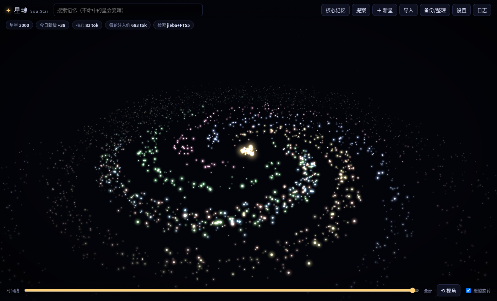

# 星魂 SoulStar · 可携带的本地 AI 记忆库

> **致谢 / 来源声明**：本项目的设计灵感与档案格式来自 **星汐 dsh-xingxi**（<https://github.com/Yuuyuko-uu/dsh-xingxi>，原作者 **Yuuyuko-uu**）。
> 星魂是独立重写的 Python 程序，没有复制星汐的源代码；它借用了星汐的「记忆卡八章 + 日记 + 原始对话」档案结构、
> 「一条记忆一颗星、越新越亮、老星只变暗不消失」的星图理念，并能直接导入星汐档案。
> 相对星汐的改动：独立运行（不依赖 DSH）、SQLite + 中文全文检索、恒定核心记忆与提案审批、按 token 预算分层召回、
> MCP 服务器、OpenAI 兼容代理、LLM 自动整理、WebDAV 加密备份、3D 星图面板。
> 星汐原许可全文见 [`LICENSE-XINGXI.txt`](LICENSE-XINGXI.txt)，说明见 [`LICENSE-NOTICE.md`](LICENSE-NOTICE.md)。



星魂把「AI 的记忆」做成一个**放在 U 盘 / 网盘里的文件夹**：换电脑、换模型、换客户端都不丢。
这个文件夹里的 `soul/`（灵魂包）就是 AI 的灵魂——模型只是来来去去的身体。

- **核心记忆**：三段恒定不变的内容（AI身份与名字 / 主人是谁及称呼 / 主人的喜好），每轮都注入，只占几十个 token；永远不会被自动改写。
- **星星**：其余所有记忆。每条一颗星，新的亮、旧的暗，被想起会重新变亮；永不硬删除，所有变化写进只追加的事件日志。
- **省 token 召回**：先看几十 token 的索引，再按预算（默认 600 token）取摘要，需要时才取全文。
- **任何模型都能用**：MCP（Claude Desktop / Cursor / Cherry Studio / Hermes Agent…）、OpenAI 兼容代理（ChatGPT 类客户端、DeepSeek、Claude 的 OpenAI 兼容端点…）、REST API。

---

## 一、快速开始（Windows + U 盘）

1. 电脑上装好 **Python 3.10 或更新版本**（<https://www.python.org/downloads/>，安装时勾选 *Add Python to PATH*）。
2. 把整个 `soulstar` 文件夹复制到 U 盘，例如 `E:\soulstar\`。
3. 双击 **`start.bat`**。
   - 第一次会在文件夹里创建 `.venv` 并安装依赖（需要联网，约 1~3 分钟）。
   - 之后会自动打开浏览器：<http://127.0.0.1:7860/>
4. 在面板里点「核心记忆」，填好三段内容，然后点「上锁」防误改。
5. 在「设置」里填上游大模型的 Base URL 和 API Key（例如 DeepSeek），就可以让客户端连上星魂了。

> 换到另一台电脑：直接插上 U 盘双击 `start.bat`。`.venv` 绑定了原电脑的 Python 路径，脚本检测到失效会自动重建，**灵魂包 `soul/` 不受影响**。
> macOS / Linux：运行 `./start.sh`。
> 也可以把文件夹放进坚果云、OneDrive、iCloud 等同步目录；**注意不要在两台电脑上同时运行同一份**（SQLite 文件同时被两端写入可能冲突），同时使用请用 WebDAV 备份/恢复来同步。

命令行参数：`python run.py --port 7860 --host 127.0.0.1 --no-browser`

---

## 二、文件夹结构

```
soulstar/
├── start.bat / start.sh      一键启动（首次自动建 .venv、装依赖、打开浏览器）
├── mcp.bat / mcp.sh          以 MCP stdio 方式启动（一般由客户端调用，不用手动点）
├── run.py                    启动器
├── mcp_server.py             MCP 服务器（官方 mcp SDK，缺失时用内置极简实现）
├── requirements.txt
├── app/
│   ├── config.py             路径 / 配置 / 机密加密（全部相对本文件夹）
│   ├── db.py                 SQLite + FTS5 + jieba 分词 + 事件日志
│   ├── core.py               核心记忆与提案
│   ├── stars.py              星星、亮度、分层召回
│   ├── semantic.py           可选语义检索（bge-small-zh）
│   ├── archive.py            原始对话归档（只追加）
│   ├── maintenance.py        LLM 整理
│   ├── proxy.py              OpenAI 兼容代理
│   ├── sync.py               快照 / WebDAV / 加密
│   ├── importers.py          导入星汐档案、markdown/txt、ChatGPT 导出
│   └── server.py             FastAPI：REST API + 面板 + 定时任务
├── web/                      面板（index.html + app.js + style.css，无需构建）
│   └── vendor/three.module.min.js   three.js 0.160（本地离线可用，缺失时自动走 CDN）
├── tests/smoke_test.py       冒烟测试
└── soul/                     ← 灵魂包（首次运行自动创建）
    ├── core.json             核心记忆（唯一真源）
    ├── core.md               核心记忆的只读镜像，方便人看
    ├── soul.db               星星、提案、全文索引（SQLite）
    ├── events.jsonl          事件日志：每次新增/修改/隐藏/召回/批准…只追加，永久可追溯
    ├── archive/              原始对话：YYYY-MM-DD.jsonl（只追加）；imported/ 存导入的原文
    ├── snapshots/            本地快照 zip
    ├── config.json           设置（含 API Key 等机密，见下文「安全」）
    └── state.json            运行状态（整理进度、上次备份时间等）
```

**备份灵魂只需要 `soul/` 文件夹**（或用面板里的快照 / WebDAV）。

---

## 三、各客户端怎么接入

星魂启动后提供三种入口，可以同时使用：

| 入口 | 地址 / 命令 | 适合 |
|---|---|---|
| OpenAI 兼容代理 | `http://127.0.0.1:7860/v1` | 任何能填「自定义 API 地址」的聊天客户端，**全自动注入记忆，模型不需要会用工具** |
| MCP（stdio） | `python mcp_server.py` | Claude Desktop、Cursor、Cherry Studio、Hermes Agent 等支持 MCP 的客户端，模型按需调用记忆工具 |
| REST API | `http://127.0.0.1:7860/api/...` | 自己写脚本、其他 Agent 框架 |

下面路径以 U 盘 `E:\soulstar` 为例，请换成你的实际路径。Windows 的 JSON 里反斜杠要写成 `\\`。

### 1. Claude Desktop（MCP）

编辑 `%APPDATA%\Claude\claude_desktop_config.json`（macOS：`~/Library/Application Support/Claude/claude_desktop_config.json`）：

```json
{
  "mcpServers": {
    "soulstar": {
      "command": "E:\\soulstar\\.venv\\Scripts\\python.exe",
      "args": ["E:\\soulstar\\mcp_server.py"]
    }
  }
}
```

重启 Claude Desktop 后会出现 6 个工具：`get_core`、`recall_index`、`recall`、`recall_detail`、`remember`、`propose_core_change`。
建议在 Claude 的「项目说明 / 个性化」里加一句：*每次对话开始先调用 get_core；需要回忆时先 recall，不要一次读全部。*

> MCP 服务器直接读写 `soul/`，**不需要先启动网页服务**；两者同时运行也没问题。

### 2. Cursor（MCP）

项目根目录 `.cursor/mcp.json`（或全局 `~/.cursor/mcp.json`），内容与上面相同：

```json
{
  "mcpServers": {
    "soulstar": {
      "command": "E:\\soulstar\\.venv\\Scripts\\python.exe",
      "args": ["E:\\soulstar\\mcp_server.py"]
    }
  }
}
```

### 3. Cherry Studio（两种方式任选）

- **代理方式（推荐，全自动注入）**：设置 → 模型服务 → 添加提供商，类型选 *OpenAI*；
  API 地址填 `http://127.0.0.1:7860`（部分版本需要填到 `http://127.0.0.1:7860/v1`），
  API 密钥填星魂设置里的「代理密钥」（没设置就随便填一个，如 `soulstar`），模型名填上游的模型名（如 `deepseek-chat`）。
- **MCP 方式**：设置 → MCP 服务器 → 添加，类型 *stdio*，命令填 `E:\soulstar\.venv\Scripts\python.exe`，参数填 `E:\soulstar\mcp_server.py`。

### 4. Hermes Agent（Nous Research）

`~/.hermes/config.yaml`：

```yaml
# 方式一：MCP 工具
mcp_servers:
  soulstar:
    command: "E:/soulstar/.venv/Scripts/python.exe"
    args: ["E:/soulstar/mcp_server.py"]

# 方式二：把星魂当作自定义 OpenAI 兼容端点（自动注入记忆）
model:
  provider: custom
  base_url: http://127.0.0.1:7860/v1
```

（Hermes 的配置项以其官方文档为准：<https://hermes-agent.nousresearch.com/docs/reference/mcp-config-reference>）

### 5. ChatGPT 类客户端（ChatBox、NextChat、LobeChat、OpenWebUI…）

凡是能填「自定义 OpenAI API 地址」的客户端：

- API 地址 / Base URL：`http://127.0.0.1:7860/v1`
- API Key：星魂的「代理密钥」（未设置则任意填写）
- 模型：上游支持的模型名

星魂收到请求后：取最后一条用户消息 → 召回相关星星（预算内）→ 把核心记忆 + 星星摘要合并进 system 提示 → 转发给上游（支持流式）→（可选）把这轮对话写入 `soul/archive/` 供日后整理。
响应头 `x-soulstar-recalled` 会列出本轮用到的星星编号。请求头加 `x-soulstar-inject: 0` 可以临时关闭注入。

### 6. 上游大模型配置示例（面板 → 设置）

| 上游 | Base URL | 模型示例 |
|---|---|---|
| DeepSeek | `https://api.deepseek.com/v1` | `deepseek-chat` |
| OpenAI | `https://api.openai.com/v1` | `gpt-4o-mini` |
| Claude（Anthropic 的 OpenAI 兼容端点） | `https://api.anthropic.com/v1` | `claude-sonnet-4-5` 等 |
| 本地 Ollama | `http://127.0.0.1:11434/v1` | `qwen2.5:7b` |
| 任意 OpenAI 兼容服务 | 服务商提供的地址 | — |

### 7. REST API 速查

```
GET  /api/core                      核心记忆
PUT  /api/core                      {"section":"identity|owner|preferences","content":"…","confirm":true}
POST /api/core/lock                 {"locked":true,"confirm":true}
GET  /api/proposals                 待批准提案；POST /api/proposals/{id}/approve {"confirm":true}
POST /api/stars                     新增星 {"content":"…","tags":["…"],"importance":3}
GET  /api/recall/index              第一层：索引
POST /api/recall                    第二层：{"query":"…","budget_tokens":600}
GET  /api/recall/detail/{id}        第三层：全文 + 原始对话
POST /api/archive                   写入对话 {"messages":[{"role":"user","content":"…"}]}
POST /api/maintenance/consolidate   让 LLM 整理新对话
POST /api/sync/snapshot | /api/sync/backup | /api/sync/restore
POST /api/import/path | /api/import/upload
```

完整接口文档：启动后打开 <http://127.0.0.1:7860/docs>。

---

## 四、为什么省 token

传统做法是每轮把整份记忆塞进上下文，记忆越多越贵、越慢、越容易被截断。星魂分三层：

| 层 | 内容 | 典型开销 |
|---|---|---|
| 核心记忆 | 三段恒定内容，每轮都带 | 几十个 token |
| `recall_index` | 星星总数、日期范围、热门标签 | 约 40 token |
| `recall(query, budget_tokens=600)` | 与问题最相关的星星**摘要**，严格不超过预算 | ≤ 600 token |
| `recall_detail(id)` | 某一颗星的全文和原始对话 | 按需 |

- 排序 = **相关度 × (1 + 0.5 × 亮度)**。相关度来自 SQLite FTS5 的 bm25（jieba 分词 + 中文二元组 + 单字兜底），装了 sentence-transformers 时再并入语义相似度。
- **亮度** = 时间衰减（半衰期默认 30 天，从「创建或上次被想起」算起）× (1 + ln(1+召回次数)) × 重要度系数 × 手动增益，最低不低于 0.08——老星变暗，但永远不会消失。
- 被召回的星会 `recall_count+1` 并重新变亮，常用的记忆自然浮上来。
- 无论记忆库有 100 颗还是 10 万颗星，每轮注入的 token 都被预算封顶。面板顶部会显示「每轮注入约 X tok」。

实测（本机 1 万颗星）：召回耗时约 0.01 秒，600 token 预算内返回 18 条摘要。

---

## 五、面板功能

- **3D 星图**：深色星空，一个 `Points` 对象承载全部星星（1 万颗以上依然流畅）。越新越靠近中心、越亮；同一标签的星落在同一条旋臂、同一种颜色。中央金色星团是核心记忆，点它直接编辑。
- 鼠标悬停高亮并显示摘要；点击打开侧栏：查看/编辑全文、摘要、标签、重要度，**变亮 / 变暗 / 隐藏（软删除）/ 恢复**，查看原始对话。
- **搜索**：不命中的星变暗，下拉列表点一条会飞过去。
- **时间线**：拖动只显示某天之前的星，看记忆如何长出来。
- **统计**：星星数、今日新增、核心 token、每轮注入 token、检索引擎。
- **核心记忆编辑器**：上锁 / 解锁，保存需要二次确认。
- **提案队列**：LLM 整理、MCP、导入产生的核心修改提案，可先改再批准或拒绝。
- **导入**、**备份/整理**、**设置**、**事件日志**。

three.js 已随包放在 `web/vendor/`，完全离线可用；如果删掉了，面板会自动从 CDN 加载。

---

## 六、LLM 自动整理（可选）

在设置里填好上游 API Key 后：

- 「备份/整理 → 立即整理」或设定「LLM 整理」间隔小时数；
- 星魂读取 `soul/archive/` 里**还没整理过**的对话，分块交给模型，提取值得长期记住的事实 → 生成星星（与近似旧星自动合并），
  并把关于身份 / 主人 / 喜好的稳定信息做成**提案**，等你在面板批准；
- 整理进度记在 `state.json`，同一段对话不会被重复处理。

**没有 API Key 时，整理功能自动跳过，其余功能完全正常。**

---

## 七、导入

面板 →「导入」，可以填本机路径，也可以上传文件：

- **星汐 dsh-xingxi 档案文件夹**（或打包成 zip 上传）：
  - `记忆卡.md` 中「一｜我是谁」整段 → **AI身份**提案（保留整段自述）；
  - 「对方是谁」→ **主人**提案，其中提到「喜欢 / 讨厌 / 不吃…」的条目 → **喜好**提案，同时也会作为星星保存；
  - 其余各章的每一条 `- ` → 一颗星（标签 = 章名）；
  - `日记/YYYY-MM-DD.md` → 每天一颗星，日期按文件名；
  - `原始对话/*.txt` → 原样存入 `soul/archive/imported/xingxi/`，永久留底。
- **普通 markdown / txt**：按列表项与段落拆星，标题作为标签，文件名里有日期就用它定日期。
- **ChatGPT 导出的 `conversations.json`**：每段对话原文进 archive（可被 LLM 整理），并生成一颗「对话标题」星。

重复导入同一份内容会自动跳过。

---

## 八、备份与同步

- **本地快照**：`soul/snapshots/soulstar-时间.zip`，默认每 24 小时一次、保留 10 个；数据库用 SQLite 在线备份接口拷贝，保证一致。
- **WebDAV**（坚果云、Nextcloud、群晖、InfiniCLOUD 等）：设置里填地址、账号、密码（坚果云请用「应用密码」）、远端目录、**备份口令**。
  - 有备份口令：快照用 PBKDF2(SHA-256, 39 万次) 派生密钥 + Fernet 加密后上传（`.zip.enc`）；
  - 没有口令：明文上传，面板会给出警告；
  - 远端只保留最近 N 个版本；可从任意版本恢复。
- 恢复前会**自动先做一次本地快照**，随时可以回退。
- 快照**不包含** `config.json`（里面有密钥），换电脑后需要重新填设置。

---

## 九、安全说明

- 服务默认只监听 `127.0.0.1`，局域网其他设备访问不到。如改成 `0.0.0.0`，请务必设置「代理密钥」，并注意面板本身没有登录密码。
- API Key、WebDAV 密码、备份口令保存在 `soul/config.json`，**默认是明文**。U 盘丢失 = 密钥泄露。
  建议在「设置 → 机密加密」里设置主密码：开启后这些字段用 PBKDF2 + Fernet 加密，每次启动需要在面板里解锁（或设置环境变量 `SOULSTAR_MASTER`）。
- 备份口令请牢记，忘了就无法解密云端备份。

---

## 十、打包成单个程序（可选）

不想在每台电脑上装 Python 时，可以用 PyInstaller 打包：

```bash
pip install pyinstaller
pyinstaller --name SoulStar --onedir --add-data "web;web" --collect-all jieba --hidden-import uvicorn.logging --hidden-import uvicorn.loops.auto --hidden-import uvicorn.protocols.http.auto --hidden-import uvicorn.lifespan.on run.py
```

（macOS / Linux 上 `--add-data` 用冒号：`"web:web"`。）打包后把 `dist/SoulStar/` 整个放到 U 盘即可，`soul/` 会创建在 exe 旁边。
MCP 服务器可同样打包 `mcp_server.py`。另一种免安装方案是使用 Python 官方的 *embeddable* 版本放进文件夹。

---

## 十一、测试

```bash
pip install -r requirements.txt
pip install wsgidav cheroot      # 可选：用于测试 WebDAV
python tests/smoke_test.py
```

冒烟测试会在临时目录建立独立灵魂包，启动真实服务器和模拟上游，验证：新增/去重、预算内召回、亮度与软删除、核心记忆锁、提案审批、
星汐/zip/markdown/ChatGPT 导入、代理注入（非流式 + 流式）、LLM 整理、MCP（官方 SDK 与内置实现）、快照恢复、WebDAV 加密备份与版本保留、机密加密、1 万颗星性能。

---

## 十二、路线图

- [ ] 面板登录密码 / 局域网访问的身份验证
- [ ] 星星之间的连线（同章近邻、共享少见词，参考星汐的星座底纹）
- [ ] MCP 的 Streamable HTTP 传输，便于远程/手机端连接
- [ ] 语义检索：后台批量补算向量、支持 ONNX 小模型免装 PyTorch
- [ ] 整理时把同一主题的多颗旧星「升华」成一颗总结星（旧星保留但变暗）
- [ ] 多设备双向合并（目前 WebDAV 是整包覆盖式恢复）
- [ ] Anthropic 原生 Messages API 代理（目前通过 Claude 的 OpenAI 兼容端点）
- [ ] 导出回星汐格式（记忆卡.md + 日记），与 DSH 互通
- [ ] 便携版 Python 一键包（免安装 Python）

---

## 十三、致谢与许可

- 星图理念、档案格式与导入兼容对象：**星汐 dsh-xingxi**，作者 **Yuuyuko-uu**，<https://github.com/Yuuyuko-uu/dsh-xingxi>。原许可全文见 `LICENSE-XINGXI.txt`，说明见 `LICENSE-NOTICE.md`。
- 3D 渲染：three.js（MIT）。中文分词：jieba（MIT）。
